# FLOW — Project VIGIL
### End-to-end operational flow: from raw tick and chat message to a signed, verified dossier

| Field | Value |
|---|---|
| Document version | 1.0.0 |
| Companions | `PRD.md` (requirements, schemas), `ARCHITECTURE.md` (components, topics, tables, state machine), `FRONTEND.md` (UI design) |
| Purpose | One place that shows **how data and decisions move** through the whole system, hop by hop, with timings, payloads, failure behavior, and how to verify each hop |

> **How to read this document.** §1 is the whole picture. §2 walks every stage (S0–S12) with a fixed template: trigger, inputs, processing, outputs, latency budget, failure behavior. §3 gives sequence diagrams for the eight critical interactions. §4 traces one worked scenario with real timestamps and payload excerpts. §5 covers failure flows, §6 chain of custody, §7 the two human workflows, §8 observability, §9 startup order, §10 per-stage verification commands. Names of topics, tables, endpoints, and fields are the ones defined in `ARCHITECTURE.md`; anything **new** introduced here is marked **[NEW]** and must be implemented exactly as written.

---

## 1. The Whole Picture

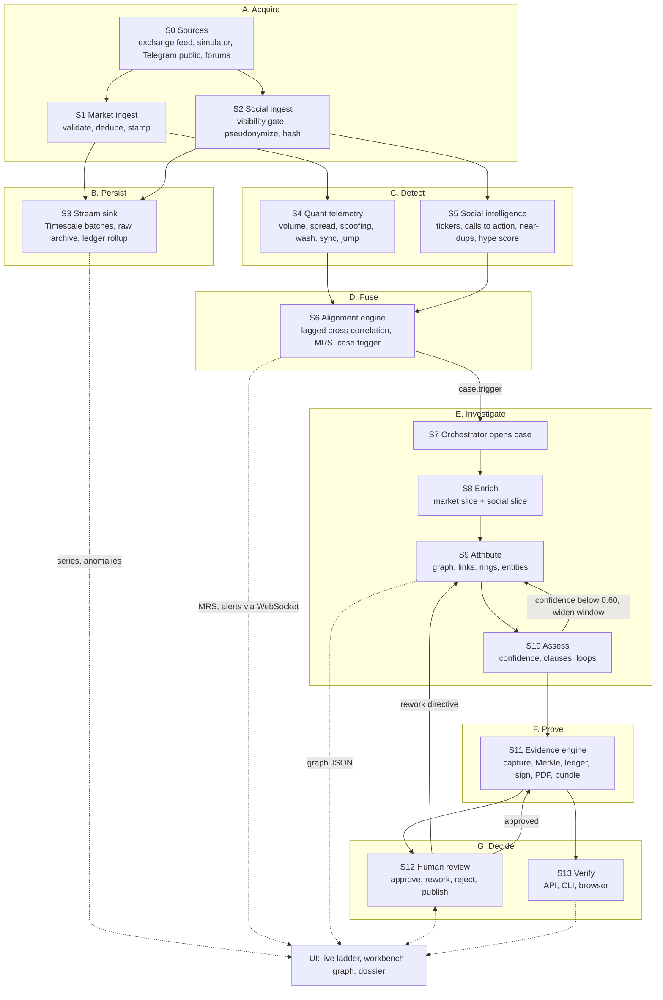

**One-sentence version of each stage**

| Stage | What it does | Main output |
|---|---|---|
| S0 | Sources emit trades, L2/L3 events, and social messages | Raw frames |
| S1 | Market ingest validates, dedupes, stamps, publishes | `market.*.raw`, `market.*.norm` |
| S2 | Social ingest enforces public/lawful-access, pseudonymizes authors, hashes the raw message | `social.messages.raw` |
| S3 | Stream sink persists everything and archives raw bytes with hashes | Timescale rows, MinIO objects, ledger entries |
| S4 | Quant agent finds statistical irregularities | `anomaly.market` |
| S5 | Social agent parses messages and scores hype | `social.signals.norm`, `anomaly.social` |
| S6 | Alignment engine tests whether chatter leads volume; computes MRS | `anomaly.fused`, `case.trigger` |
| S7–S10 | Orchestrator runs the case: enrich, attribute, assess | Case state, rings, confidence |
| S11 | Evidence engine hashes, signs, renders | Signed dossier bundle |
| S12 | A human approves, requests rework, or rejects | `human_review`, new signed version |
| S13 | Anyone with the bundle and public key can verify | Verification report |

---

## 2. Stage-by-Stage Flow

Each stage uses the same template. "Budget" is the latency allowance for that stage alone; §2.14 sums them.

### S0 — Sources
| Item | Detail |
|---|---|
| Trigger | Continuous |
| Inputs | Exchange/regulator privileged feed (production); `ws://simulator:8090/ws/market` and `/ws/social` (MVP); public Telegram channels (optional adapter) |
| Output | Frames `{"kind":"trade\|l2\|l3","data":{…}}` for market, `SocialMessage`-shaped JSON for social |
| Rule | Private or invite-only channels are never read. Only `channel_visibility ∈ {public, lawful_access}` proceeds |

### S1 — Market ingest (`market_ingest`)
| Item | Detail |
|---|---|
| Trigger | One WebSocket frame |
| Steps | 1. `t_recv = time_ns()` immediately on receive. 2. Publish **raw bytes** to `market.<kind>.raw` (byte-exact, for evidence). 3. `orjson.loads`. 4. Validate against the compiled JSON Schema. 5. Dedupe: in-process LRU, then Redis `SET NX EX 600` on `dedupe:{stream}:{event_id}`. 6. Per-symbol `seq` check (gap → `health.events` `SEQ_GAP`). 7. Stamp `ts_received`, `ts_ingest`, `ingest_latency_us`. 8. Publish to `market.<kind>.norm`. 9. Observe `vigil_ingest_latency_seconds`. |
| Outputs | `market.trades.raw|norm`, `market.l2.raw|norm`, `market.l3.raw|norm`, `dlq.market`, `health.events` |
| Budget | **p99 < 200 ms** from step 1 to step 8 ack (NFR-PERF-01) |
| Failure | Invalid schema → DLQ with `{original_b64, error, stage:"validate"}`. Duplicate → counted, dropped. Overload (queue > 50k) → shed **L2 deltas only**, never trades or L3. Kafka unavailable → bounded in-memory queue, then shed per rule, `health.events` `KAFKA_DOWN` |

### S2 — Social ingest (`social_ingest`)
| Item | Detail |
|---|---|
| Trigger | One message from an adapter |
| Steps | 1. Visibility gate. 2. `author_id = b64url(HMAC_SHA256(PEPPER, "handle\|"+platform+"\|"+raw_author)[:16])`. 3. `raw_sha256 = sha256(canonical raw JSON)`. 4. Validate against `social_message` schema. 5. Dedupe on `(platform, channel_id, message_id)`. 6. Publish to `social.messages.raw` keyed by `channel_id`. |
| Outputs | `social.messages.raw`, `dlq.social` (`VISIBILITY_NOT_PERMITTED`, `SCHEMA_INVALID`) |
| Budget | p99 < 200 ms (same NFR) |
| Failure | Adapter disconnect → exponential reconnect (1, 2, 4 … 30 s) and `health.events` `ADAPTER_DOWN`; no data is fabricated |

### S3 — Stream sink (`stream_sink`)
| Item | Detail |
|---|---|
| Trigger | Batch of ≤ 2000 records or 200 ms |
| Steps (Timescale) | `copy_records_to_table` into a temp table → `INSERT … ON CONFLICT DO NOTHING` into `trades`, `orders_l3`, `l2_snapshots`, `social_messages`, `social_signals`, `hype_scores`, `anomalies`, `mrs_1m`, `l2_metrics_1s`, `case_events` → commit Kafka offsets |
| Steps (archive) | Roll hourly or at 64 MB → zstd NDJSON → SHA-256 → upload `vigil-raw/…` → ledger entry `EVIDENCE` with `{uri, topic, partition, offset_start, offset_end}` |
| Budget | Write visible in Timescale within 1 s of Kafka commit |
| Failure | DB down → consumers pause (no commit), lag grows, backpressure alert; replay on recovery is idempotent through primary keys |

### S4 — Quant telemetry (`quant_telemetry`)
| Item | Detail |
|---|---|
| Trigger | Event on `market.*.norm` (partition-owned, event-time ordered) |
| Detectors | Volume spike, spread/depth, spoofing/layering, wash cycle (market level), synchronized orders, price jump (formulas in `ARCHITECTURE.md` §7.1) |
| Output | `AnomalyEvent` on `anomaly.market`; `l2_metrics_1s` rows; `GraphUpdate` hints for `SYNCHRONIZED_WITH`; adds symbol to `watchlist:symbols` |
| Budget | Event time to anomaly published: p95 < 2 s |
| Failure | Consumer crash → restart from committed offset, warm state from `state:qta:{symbol}` snapshot (every 30 s) |

### S5 — Social intelligence (`social_intel`)
| Item | Detail |
|---|---|
| Trigger | Message on `social.messages.raw` |
| Fast path | Language detect → NFKC → ticker extraction (cashtag, alias, company name) → rule-based call-to-action class → urgency → MinHash near-duplicate → cascade depth → emit `SocialSignal` (`parser.mode="FALLBACK_RULES"`). Always runs, never waits on an LLM |
| LLM path | Only if `ticker_confidence < 0.8`, or (`NEUTRAL` and `urgency ≥ 0.5`), or language outside {en, hi}. Batch ≤ 20, concurrency 8, timeout 2 s. Valid JSON → refined signal (`parser.mode="LLM"`), else keep fast-path result |
| Hype scorer | Sliding 60 s window, step 5 s, per ticker → `hype_scores` and `HYPE_BURST` (score ≥ 70 for ≥ 30 s) or `NEAR_DUPLICATE_CAMPAIGN` |
| Budget | Fast-path signal p95 < 1 s; hype score p95 < 10 s |
| Failure | LLM outage → fast path only, `health.events` `LLM_UNAVAILABLE` (the UI shows "Parsing in rules-only mode") |

### S6 — Alignment engine (`alignment_engine`)
| Item | Detail |
|---|---|
| Trigger | Every 5 s per hot ticker (hype ≥ 40 or volume z ≥ 2 in last 10 min), or an arriving `HYPE_BURST` |
| Steps | 1. Load 1 s series (bars, hype, l2 metrics). 2. **Fast rule:** `HYPE_BURST` followed by `VOLUME_SPIKE` or `PRICE_JUMP` within 15 min → provisional alignment. 3. **Full test:** normalized cross-correlation over lags −120…+1800 s, circular block-shuffle permutation test (500 shuffles). 4. Compute MRS per minute. 5. If qualifying and no overlapping open case → publish `CROSS_MODAL_ALIGNMENT` to `anomaly.fused` and `CaseTrigger` to `case.trigger`. |
| Output | `anomaly.fused`, `case.trigger`, `mrs_1m`, Redis `mrs:{symbol}` |
| Budget | Fast rule: next 5 s cycle after the second anomaly. Full test: ≤ 3 s in `ProcessPoolExecutor` |
| Failure | Executor error → fast rule result still triggers, metrics note `permutation_skipped=true` |

### S7 — Orchestrator opens the case
| Item | Detail |
|---|---|
| Trigger | `CaseTrigger` consumed from `case.trigger` (group `orchestrator`) |
| Steps | Overlap check (same symbol, windows overlap ≥ 50 %): if yes, **merge** (append anomaly, add flag `NEW_EVIDENCE_AVAILABLE` if the case is past DRAFTING, see §7.3 **[NEW]**) and stop. Else insert `cases` row, set window = `[first_trigger − 10 min, now + 5 min]`, emit `CASE_OPENED` on `case.events`, start the LangGraph run with `thread_id = case_id` |
| Budget | Case row exists ≤ 10 s after the alignment anomaly (AC-ALN-01) |

### S8 — Enrich
| Item | Detail |
|---|---|
| Steps | Fan out in parallel over Redis Streams: `REQUEST_MARKET_SLICE` to QTA, `REQUEST_SOCIAL_SLICE` to SIA. Each agent queries Timescale, writes a slice NDJSON.zst to `vigil-evidence/…`, returns summary + `{uri, sha256, bytes}` |
| Budget | 30 s per slice, 2 retries (2 s, 4 s backoff) |
| Fallback | One slice missing → continue with flag `MISSING_*_SLICE` and lower completeness. Both missing → `FAILED` |

### S9 — Attribute
| Item | Detail |
|---|---|
| Steps | `REQUEST_ATTRIBUTION` to CAA: candidates → evidence links (shared device, network, KYC hash, latency signature, broker pathway, cycles via Cypher Q1, synchronized orders via Q2, reaction latency via Q5) → noisy-OR pair confidence → `LINKED` edges at ≥ 0.60 → components, Louvain refinement above 40 nodes → `Entity` nodes with `ring_score` → graph export |
| Output | `{rings[], leads[], metrics, graph_export_uri, sha256}` |
| Budget | 90 s |
| Fallback | Timeout → partial results from continuous loader, flag `PARTIAL_ATTRIBUTION`. Neo4j down → NetworkX run over the SQL slice, flag `ATTRIBUTION_SQL_ONLY` |

### S10 — Assess
| Item | Detail |
|---|---|
| Steps | Compute `alignment_conf`, `attribution_conf`, `market_conf`, `completeness`, `overall` (formula `ARCHITECTURE.md` §7.6). Map clauses from `regulatory_clauses.yaml` by finding type and jurisdiction. Decide the route |
| Routes | `overall ≥ 0.60` → draft. `0.40 ≤ overall < 0.60` and `widen_count < 2` → widen window ±50 % and loop to S9. `overall < 0.40` after loops → `CLOSED_NO_ACTION`. `alignment weak` → `WATCHLIST` |
| Budget | 10 s per pass |

### S11 — Evidence engine
| Item | Detail |
|---|---|
| Steps | 1. **Capture** every evidence object (slices, anomaly JSONs, graph export, chart PNG, LLM trace, config snapshot) → SHA-256 → upload → `evidence_objects` → ledger `EVIDENCE`. 2. **Draft** narrative: LLM structured output, validated; else deterministic template. 3. **Validate**: schema, citation check (every claim cites a resolvable `evidence_id`), numeric consistency. 4. **Merkle** root over evidence hashes. 5. **Sign**: JCS canonicalize, SHA-256, Ed25519. 6. **Ledger** `DOSSIER` entry. 7. **Render** PDF, QR, **bundle** ZIP. |
| Budget | Draft-to-signed p95 < 2 min |
| Failure | LLM invalid twice → template narrator, flag `LLM_UNAVAILABLE`. Signer down after 3 tries → `FAILED` + `SIGNER_DOWN` alert |

### S12 — Human review
| Item | Detail |
|---|---|
| Trigger | Case at `PENDING_REVIEW` (LangGraph `interrupt()`) |
| Steps | Compliance officer opens the dossier, sees live verification, decides `APPROVED`, `REWORK`, or `REJECTED` with a comment (required for the last two). Approval re-enters the graph at `publish`, which fills `human_review`, creates **version n+1** (`supersedes = n`), signs again, sets `PUBLISHED`. Rework routes back to `attribute` (directive-driven) or `draft` (comment-only) |
| Gate | Without an authenticated `compliance_officer` decision the case can never reach `PUBLISHED` (HTTP 409 otherwise, AC-DOS-06) |
| SLA | Alert on `health.events` if a case waits more than 24 h |

### S13 — Verify
| Item | Detail |
|---|---|
| Entry points | `GET /dossiers/{id}/verify` (live, server), `POST /verify` (uploaded bundle), `vigil-verify` CLI (offline), `/verify` page (browser, client-side) |
| Checks | `SCHEMA_VALID`, `EVIDENCE_HASHES`, `MERKLE_ROOT`, `LEDGER_CHAIN`, `SIGNATURE`, `HUMAN_REVIEW_PRESENT` |
| Result | `{valid, checks[], failed[]}` where `failed` entries are `HASH_MISMATCH`, `MERKLE_MISMATCH`, `LEDGER_CHAIN_BROKEN`, `SIGNATURE_INVALID`, `SCHEMA_INVALID` |

### 2.14 End-to-end latency budget

| Segment | Budget | Cumulative (typical) |
|---|---|---|
| Source frame → normalized publish (S1/S2) | p99 < 200 ms | 0.2 s |
| Normalized → persisted (S3) | < 1 s | 1.2 s |
| Normalized → anomaly (S4) | p95 < 2 s | 2.2 s |
| Message → hype score (S5) | p95 < 10 s | 10 s (parallel with S4) |
| Second anomaly → alignment alert (S6) | ≤ 5 s | ≤ 15 s |
| Alert → case row (S7) | ≤ 10 s | ≤ 25 s |
| Enrich (S8) | ≤ 30 s | ≤ 55 s |
| Attribute (S9) | ≤ 90 s | ≤ 145 s |
| Assess (S10) | ≤ 10 s | ≤ 155 s |
| Draft, validate, sign (S11) | ≤ 120 s | ≤ 275 s |
| **Case open to awaiting review** | **p95 < 5 min (300 s)** | **≈ 4.6 min** |

---

## 3. Sequence Diagrams

### 3.1 Market tick, from socket to anomaly

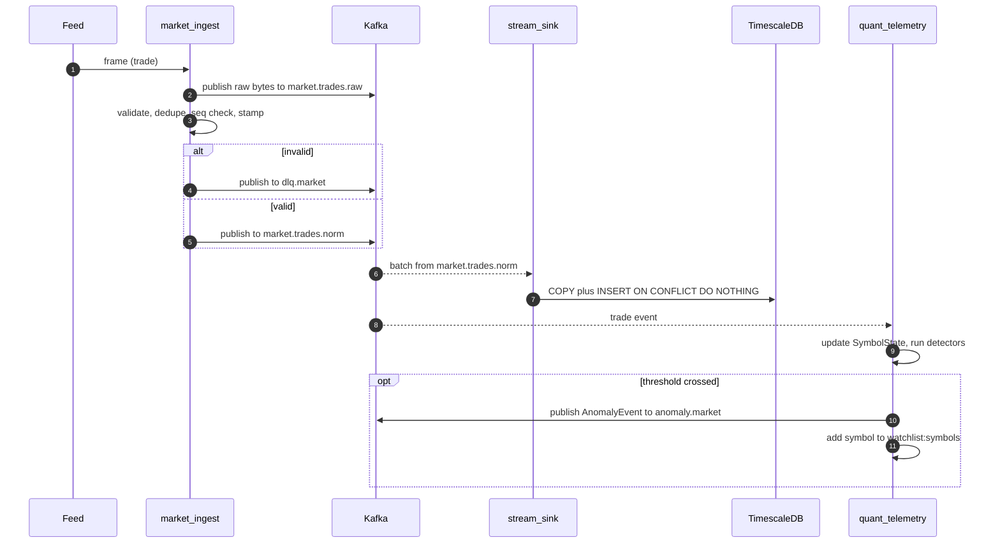

### 3.2 Social message, from channel to hype burst

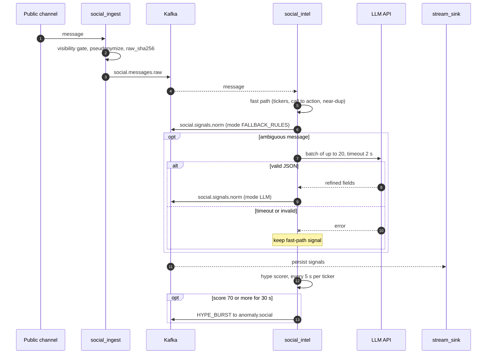

### 3.3 Alignment to case trigger to orchestration start

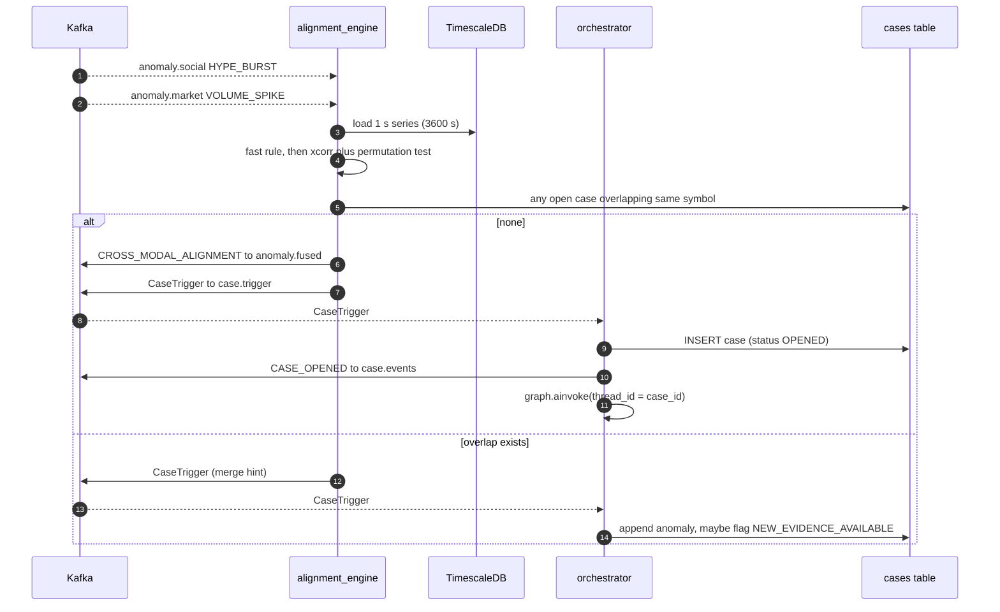

### 3.4 Enrich and attribute (agent tool calls over Redis Streams)

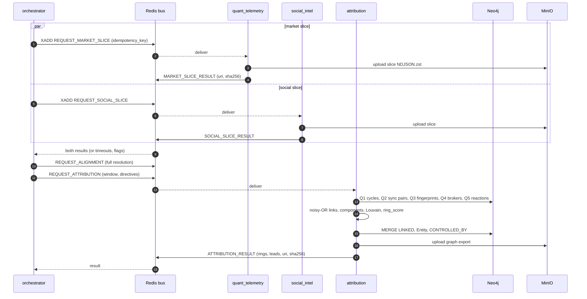

### 3.5 Assess, draft, validate, sign

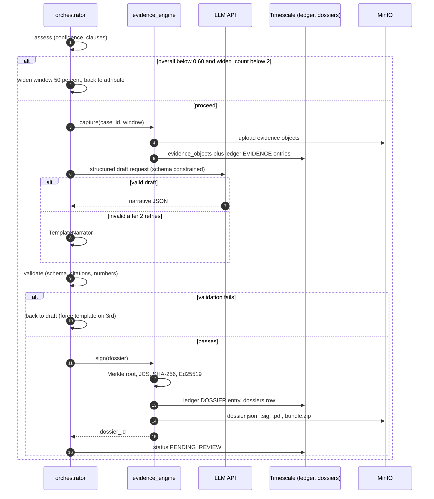

### 3.6 Human review and publication

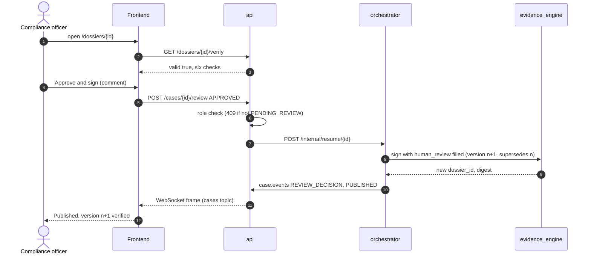

### 3.7 Investigator steers the analysis (directive loop)

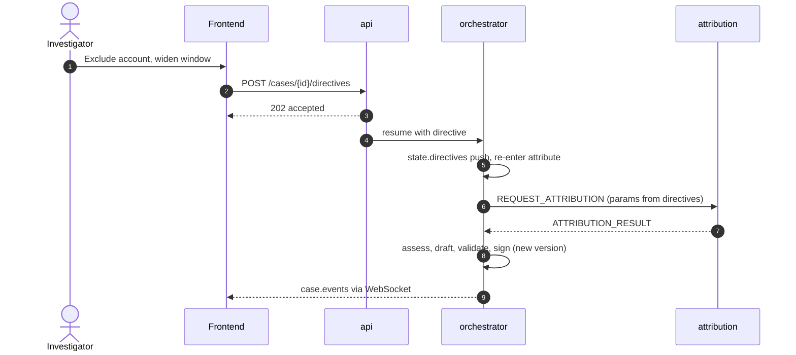

### 3.8 Live UI streaming

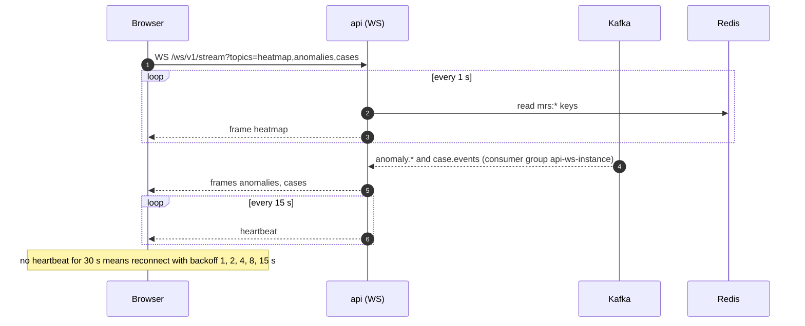

---

## 4. Worked Example: scenario `pump_dump_ring_01`

Seed 42. Simulation clock starts at `2026-03-14T04:25:00Z`. Target ticker `ZENITHSME` (micro tier). Ground truth: 20 ring accounts, 3 brokers, 5 shared devices, lag 150 s, dump at `+1140 s`.

| Clock (UTC) | Stage | What happens | Artifact |
|---|---|---|---|
| 04:25:00 | S0 to S3 | Baseline flow, about 0.4 trades/s on ZENITHSME, ambient chatter | `trades`, `social_messages` rows |
| 04:30:00.4 | S2 | First coordinated message in channel A: "ZENITHSME 10 minute mein 2x, sab 4:32 pe lagao" | `SocialMessage`, `raw_sha256=9f2c…` |
| 04:30:00.9 | S5 | Fast path: ticker `ZENITHSME` (0.97), `COORDINATION_TIMING`, scheduled time 04:32, urgency 0.92, Hinglish so LLM refinement queued (2 s timeout) | `SocialSignal`, `parser.mode=FALLBACK_RULES` then `LLM` |
| 04:30:47 | S5 | Hype stays at or above 70 for 30 s (rate z 6.1, unique authors z 5.4, near-dup ratio 0.52, 3 channels) | `HYPE_BURST` score 0.81 on `anomaly.social` (**within 60 s of first coordinated message**, AC-SOC-03) |
| 04:32:30 | S1 | Ring accounts begin buying, 6 to 9 orders/s | Trades with shared `device_fp` and `asn=55836` |
| 04:32:45 | S4 | Robust z of 5 s volume at or above 4.0 for 3 bins | `VOLUME_SPIKE` score 0.64 |
| 04:32:50 | S6 | Fast rule: burst precedes spike by 123 s. Provisional alignment | `CROSS_MODAL_ALIGNMENT` (provisional) and `CaseTrigger` |
| 04:32:56 | S7 | Case opened. Window `[04:20:00, 04:37:50]`. Status `OPENED` | `case_id=0192f5e1-…`, `CASE_OPENED` |
| 04:33:20 | S8 | Slices returned: 11,402 trades, 612 messages, 3 channels, hype peak 88.4 | Two evidence objects, ledger `EVIDENCE` x2 |
| 04:33:31 | S6 (full) | Full test: `best_lag_s=149`, `xcorr_peak=0.78`, `p=0.002` (within ±30 s of truth 150, AC-ALN-01) | Updated alignment in case state |
| 04:34:12 | S9 | Q1 returns 6 cycles (lengths 2 to 4). Q3: 5 shared devices over 17 accounts. Q2: 41 synchronized pairs. Noisy-OR links at or above 0.6: 94. Entity with 19 of 20 ring accounts (recall 0.95, precision 1.0). `ring_score=0.93` | `ATTRIBUTION_RESULT`, `LINKED` edges |
| 04:34:20 | S10 | `alignment_conf 0.78`, `attribution_conf 0.91`, `market_conf 0.82`, `completeness 1.0` gives overall **0.87**. Clauses mapped (SEBI Reg. 3 and 4(2), SEC §9(a)(1), §9(a)(2), §10(b)) | Route to draft |
| 04:35:40 | S11 | Capture 14 evidence objects, template narrative (LLM key unset in this run), Merkle root `c41e…`, signature Ed25519 `dev-2026-01` | Dossier v1, bundle |
| 04:36:25 | S12 | Case `PENDING_REVIEW` (**3 min 29 s after open**, AC-ORC-01) | `REVIEW_REQUESTED` |
| 04:44:00 | S1 to S4 | Dump begins (price falls 30 %). New anomalies on same symbol overlap the open case | Orchestrator merges, sets flag `NEW_EVIDENCE_AVAILABLE` |
| 04:47:10 | UI | Reviewer sees the banner "New activity since version 1" and chooses Regenerate | `FORCE_REATTRIBUTION` directive with window end extended |
| 04:49:30 | S11 | Dossier v2 signed, `supersedes=v1`, now includes dump phase and a second timeline phase | Dossier v2 |
| 04:52:05 | S12 | Compliance officer approves with comment. Version 3 is signed with `human_review.status=APPROVED` | Dossier v3, status `PUBLISHED` |
| 04:52:40 | S13 | Bundle downloaded, `vigil-verify` exits 0. One flipped byte in an evidence file gives exit 1 with `HASH_MISMATCH` | Verification report |

### 4.1 Payload excerpts along the path

**S1 output, `market.trades.norm` (trimmed)**
```json
{"schema_version":"1.0.0","event_id":"0192f5e3-0a11-7c21-9d4e-1b2a3c4d5e6f","exchange":"SYNTH","symbol":"ZENITHSME",
 "trade_id":"T-000184233","seq":184233,"ts_exchange":"2026-03-14T04:32:41.123456789Z",
 "ts_received":"2026-03-14T04:32:41.130002114Z","ts_ingest":"2026-03-14T04:32:41.134100908Z","ingest_latency_us":4098,
 "price":"41.35","qty":1200,"aggressor_side":"BUY",
 "buyer":{"account_id":"Zx9fQ2mLpA7vT1kRwE4yBg","broker_id":"BRK-07","device_fp":"Dv3aK9pQ1xZ7mT2rWc8LsA","asn":55836},
 "seller":{"account_id":"Qm1vB7nT3kP9xR5wL2cYdA","broker_id":"BRK-11"},"is_synthetic":true}
```

**S5 output, `social.signals.norm` (trimmed)**
```json
{"schema_version":"1.0.0","signal_id":"0192f5e2-7b00-7a10-8e11-000000000042","ticker":"ZENITHSME","ticker_confidence":0.97,
 "cta_class":"COORDINATION_TIMING","cta_confidence":0.9,"scheduled_action_time":"2026-03-14T04:32:00Z","urgency":0.92,
 "near_dup_cluster_id":"nd-7c1","raw_sha256":"9f2c…","parser":{"mode":"LLM","version":"sia-1.0.0","llm_model":"claude-sonnet-5-5"}}
```

**S6 output, `case.trigger`**
```json
{"trigger_anomaly_id":"0192f5d0-1111-7a00-8c00-aaaaaaaaaaaa","symbol":"ZENITHSME","exchange":"SYNTH",
 "first_trigger_ts":"2026-03-14T04:30:47Z","window_hint":{"start":"2026-03-14T04:20:00Z","end":"2026-03-14T04:37:50Z"},
 "provisional":true}
```

**S9 output, `ATTRIBUTION_RESULT.payload` (trimmed)**
```json
{"rings":[{"ring_id":"R1","entity_id":"ent-3b9","ring_score":0.93,"accounts":["Zx9f…","Aq2m…","…19 total"],
 "methods":["SHARED_DEVICE","SHARED_NETWORK","CIRCULAR_CYCLE","SYNCHRONIZED_ORDERS","REACTION_LATENCY"],
 "cycle_count":6,"net_volume":186400,"evidence_ids":["EV-GRAPH_EXPORT-3a91c0e7b2d4","EV-TRADE_SLICE-f10c22a98b11"]}],
 "leads":[{"account_id":"Mn7p…","confidence":0.52,"note":"Single-method link (broker pathway)"}],
 "graph_export_uri":"s3://vigil-evidence/0192f5e1-…/EV-GRAPH_EXPORT-3a91c0e7b2d4.json","sha256":"3a91c0e7b2d4…"}
```

**S11 output, ledger rows (trimmed)**

| entry_id | entry_type | actor | subject_sha256 | prev_entry_hash | entry_hash |
|---|---|---|---|---|---|
| 1201 | EVIDENCE | evidence_engine | f10c22a9… | e8b4… | 51aa… |
| 1202 | EVIDENCE | evidence_engine | 3a91c0e7… | 51aa… | 77d0… |
| … | … | … | … | … | … |
| 1214 | DOSSIER | evidence_engine | 9b0e5d61… (JCS digest) | 6c20… | a3f9… |
| 1215 | HUMAN_ACTION | compliance:arjun.m | 5d77… (decision hash) | a3f9… | 0d12… |
| 1216 | DOSSIER | evidence_engine | c8e1… (v3 digest) | 0d12… | f4b7… |

---

## 5. Failure and Degradation Flows

| What fails | Detected by | System behavior | Visible to the user | Recovery |
|---|---|---|---|---|
| LLM API unreachable or slow | Timeout > 2 s, invalid JSON | Fast-path signals continue. Dossier uses `TemplateNarrator`. Flag `LLM_UNAVAILABLE` | Banner "Parsing in rules-only mode". Dossier limitations list it | Automatic when API returns |
| Kafka consumer crash | Container restart, lag metric | Resume from committed offset, warm state from Redis snapshot | Admin health shows lag spike | Automatic |
| Kafka unavailable at ingest | Produce errors | Bounded queue, then shed L2 deltas only (never trades or L3) | "Ingest degraded" chip on `/live` | Automatic, shed counters recorded |
| TimescaleDB down | Sink write errors | Consumers pause without commit. Alignment pauses. API read routes return 503 `problem+json` | Header status "Data store unavailable" | Replay is idempotent (primary keys) |
| Neo4j down | Driver errors | Graph writes buffered in `graph.updates` (7 d). Case attribution uses NetworkX on SQL slice, flag `ATTRIBUTION_SQL_ONLY` | Graph page shows "Graph store offline, showing SQL-derived links (no device/broker nodes)" | Writer drains buffer on return |
| Redis down | Client errors | Agents lose warm-state snapshots and fall back to in-memory only. Agent RPC unavailable, so orchestrator retries 2 times then flags missing slices | Cases show "Gathering data" longer. Heatmap polls fail, ladder freezes with "Last update" time | Automatic |
| Orchestrator killed mid-case | Container restart | LangGraph resumes from last checkpoint. Idempotency keys prevent duplicate evidence, ledger, dossiers (AC-ORC-02) | Case shows a short pause, no duplicates | Automatic |
| Signer unavailable | Sign errors x3 | Case → `FAILED`, `SIGNER_DOWN` on `health.events` | Failed case with plain reason and "Retry signing" action for admins | Fix key/Vault, use retry |
| Invalid dossier draft | Validator | Back to draft (≤ 2), third time forces template | None unless flagged | Automatic |
| Sequence gap in feed | Seq check | `SEQ_GAP` event, detector continues but marks window `data_gap=true` in metrics | Live ladder shows a gap marker | Operator reviews feed |
| Duplicate or replayed events | Dedupe, primary keys | Dropped and counted | None | None needed |
| Tampering (bundle or DB) | Verifier, DB triggers | `valid:false` with named failed check. SQL `UPDATE/DELETE` on ledger raises exception | Seal-red integrity panel naming the failed check | Re-export from source of truth, investigate |

---

## 6. Chain of Custody Flow

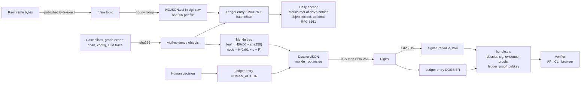

**Chain of custody guarantees and where each is enforced**

| Guarantee | Mechanism | Enforced by |
|---|---|---|
| Inputs are preserved exactly | Byte-exact raw topics, hashed archives | `market_ingest`, `stream_sink` |
| Order and non-deletion of evidence records | Hash-chained, append-only ledger, DB triggers block `UPDATE/DELETE/TRUNCATE` | Postgres triggers + `evidence_engine` single writer with advisory lock |
| Evidence set is complete and unchanged | Merkle root in the signed dossier | `evidence_engine`, verifier |
| Dossier is authentic and unmodified | Ed25519 over JCS digest | Signer, verifier |
| A human took responsibility | `human_review` is inside the signed payload, plus `HUMAN_ACTION` ledger entry | `orchestrator.publish` |
| Ledger not rewritten later | Daily anchor in object-locked storage (and optional TSA token) | `evidence_engine.anchor` |
| Every automated decision is reconstructible | `AGENT_DECISION` and `LLM_CALL` ledger entries, `CONFIG_SNAPSHOT` evidence with `config_hash` | Agents, orchestrator |

---

## 7. Human Workflows (UI → API → services)

### 7.1 Forensic investigator

| # | Investigator does | UI route | API call | Service reaction |
|---|---|---|---|---|
| 1 | Watches the ladder, notices ZENITHSME rising | `/live` | WS `heatmap`, `anomalies` | S6 writes `mrs:*` each 5 s |
| 2 | Opens the auto-created case | `/cases/{id}` | `GET /cases/{id}`, `GET /cases/{id}/series` **[NEW]**, `GET /cases/{id}/timeline` | Reads Timescale and case state |
| 3 | Reads the lag bracket, checks evidence tags | same | `GET /cases/{id}/evidence`, `GET /evidence/{id}/download` | Presigned MinIO download |
| 4 | Explores the ring | `/cases/{id}/graph` | `GET /cases/{id}/graph?min_conf=0.6` | Neo4j Q7 export |
| 5 | Marks a link as a false positive | graph inspector | `POST /cases/{id}/links/feedback` | CAA vetoes link, recomputes entity, ledger `HUMAN_ACTION`, `case.events` `LINK_FEEDBACK` |
| 6 | Widens the window to ±2 h | case page, "Adjust analysis" | `POST /cases/{id}/directives` | Orchestrator re-enters S9 |
| 7 | Reviews narrative and clauses | `/dossiers/{id}` | `GET /dossiers/{id}` | Read |
| 8 | Sends for review | case page | `POST /cases/{id}/submit` | Case becomes (or stays) `PENDING_REVIEW` |

### 7.2 Regulatory compliance officer

| # | Officer does | UI route | API call | Service reaction |
|---|---|---|---|---|
| 1 | Opens queue "Awaiting review" | `/cases?status=PENDING_REVIEW` | `GET /cases` | Read |
| 2 | Opens dossier and sees live integrity result | `/dossiers/{id}` | `GET /dossiers/{id}/verify` | Verifier runs six checks |
| 3 | Reads timeline, clauses (advisory), limitations | same | `GET /dossiers/{id}` | Read |
| 4 | Decides | review panel | `POST /cases/{id}/review` | Orchestrator resumes: publish (new signed version), rework (back to S9 or S11), reject (terminal) |
| 5 | Exports | same | `GET /dossiers/{id}/bundle`, `/pdf` | Streams from MinIO |
| 6 | Counsel verifies offline | CLI or `/verify` | none (local) | Five checks recomputed independently |
| 7 | Re-identifies an account (exception path) | account menu | `POST /accounts/{id}/reveal` | Pepper registry lookup, audit row, ledger entry |

### 7.3 Late evidence after a dossier exists **[NEW]**
1. Overlap-merge (S7) appends later anomalies to the existing case.
2. If the case stage is `PENDING_REVIEW`, `REWORK`, or `PUBLISHED`, orchestrator adds flag `NEW_EVIDENCE_AVAILABLE` and emits `case.events` `FLAG_ADDED`. It **never** edits a signed dossier.
3. UI shows the banner "New activity since version {n}" with the action **Regenerate dossier** (investigator or compliance role).
4. The action posts directive `FORCE_REATTRIBUTION` with `params.window_end = now`. The graph re-runs S8 to S11 and produces version n+1 with `supersedes = n`.
5. Published versions remain retrievable and verifiable forever.

### 7.4 Case event catalogue **[NEW]** (`case.events`, `case_events.kind`)

| kind | Emitted when | Payload keys |
|---|---|---|
| `CASE_OPENED` | S7 | `case_id, symbol, window, trigger_anomaly_id` |
| `SLICE_RECEIVED` | S8 | `slice: market\|social, evidence_id, rows` |
| `ALIGNMENT_COMPUTED` | S6/S8 | `best_lag_s, xcorr_peak, p_value, provisional` |
| `ATTRIBUTION_STARTED` / `ATTRIBUTION_DONE` | S9 | `params` / `rings, leads_count, flags` |
| `CONFIDENCE_ASSESSED` | S10 | `overall, components, route` |
| `WINDOW_WIDENED` | S10 | `old_window, new_window, widen_count` |
| `DOSSIER_DRAFTED` | S11 | `narrative_mode` |
| `VALIDATION_FAILED` | S11 | `errors[], attempt` |
| `DOSSIER_SIGNED` | S11 | `dossier_id, version, digest_sha256, key_id` |
| `REVIEW_REQUESTED` | S11 end | `dossier_id` |
| `REVIEW_DECISION` | S12 | `status, reviewer_id, comment_hash` |
| `PUBLISHED` | S12 | `dossier_id, version` |
| `DIRECTIVE_RECEIVED` | API | `type, params, user_id` |
| `LINK_FEEDBACK` | API | `a_account, b_account, verdict` |
| `FLAG_ADDED` | any | `flag` |
| `FAILED` | any | `reason, node` |

---

## 8. Observability Flow

| Signal | Name / location | Produced by | Used for |
|---|---|---|---|
| Ingest latency | `vigil_ingest_latency_seconds{stream}` histogram | S1, S2 | NFR-PERF-01 alert at p99 > 0.18 s |
| Detection latency | `vigil_detect_latency_seconds{agent}` | S4, S5, S6 | NFR-PERF-03 |
| Consumer lag | `kafka_consumer_lag{group,topic}` | exporter | KEDA scaling, backpressure alerts |
| DLQ rate | `vigil_dlq_total{stream,reason}` | S1, S2 | Data quality |
| Shed counters | `vigil_ingest_shed_total{kind}` | S1 | Overload visibility |
| LLM mode ratio | `vigil_parser_mode_total{mode}` | S5 | Cost and degradation |
| Case duration | `vigil_case_duration_seconds{stage}` | Orchestrator | NFR-PERF-04 |
| Ledger head | `vigil_ledger_head_id` and daily anchor job status | Evidence engine | Integrity monitoring |
| Traces | OTel, `traceparent` Kafka header | all | Follow one message from socket to dossier |
| Logs | structlog JSON with `case_id, symbol, agent, trace_id` | all | Forensics of the platform itself |

**Trace propagation rule:** the ingest service creates the root span and writes `traceparent` into every Kafka header; consumers continue it; agent RPC messages carry `traceparent` inside `AgentMessage.payload._trace`. The orchestrator links all case spans to the case with attribute `vigil.case_id`.

---

## 9. Startup and Readiness Flow

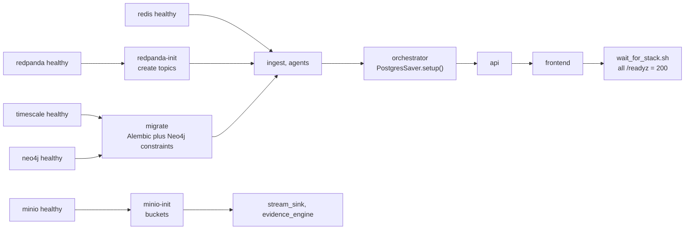

`/readyz` semantics per service: Kafka reachable, required DB reachable, schemas loaded, config valid. `wait_for_stack.sh` polls every service's `/readyz` for up to 180 s and exits non-zero on timeout.

---

## 10. Per-Stage Verification (copy-paste checks)

Assumes `make up` finished and `TOKEN` is set (see `scripts/smoke_test.sh`).

| Stage | Command | Expect |
|---|---|---|
| S0 | `curl -s localhost:8090/status \| jq` | `running` and scenario id after `make scenario ID=pump_dump_ring_01` |
| S1 | `docker compose exec redpanda rpk topic consume market.trades.norm -n 3 -f '%v\n'` | Three valid `TradeTick` JSON lines with `ingest_latency_us` |
| S1 | `curl -s localhost:9090/api/v1/query --data-urlencode 'query=histogram_quantile(0.99, sum(rate(vigil_ingest_latency_seconds_bucket[1m])) by (le))'` | Value < 0.2 |
| S2 | `rpk topic consume social.messages.raw -n 3` | `channel_visibility` is `public` or `lawful_access` |
| S3 | `psql $PG_DSN -c "select count(*) from vigil.trades"` twice, 5 s apart | Count rises |
| S4 | `curl -s -H "authorization: Bearer $TOKEN" "$API/anomalies?symbol=ZENITHSME&type=VOLUME_SPIKE"` | At least one item |
| S5 | `curl -s … "$API/anomalies?symbol=ZENITHSME&type=HYPE_BURST"` | One item, `window_start` within 60 s of first coordinated message |
| S6 | `curl -s … "$API/anomalies?type=CROSS_MODAL_ALIGNMENT"` | `metrics.best_lag_s` within ±30 s of 150 |
| S7 | `curl -s … "$API/cases?symbol=ZENITHSME"` | One case, status progressing |
| S8–S10 | `curl -s … "$API/cases/$CID/timeline" \| jq length` | Entries on `SOCIAL`, `MARKET`, `GRAPH` tracks |
| S9 | `curl -s … "$API/cases/$CID/graph" \| jq '.nodes\|length'` | ≥ 15 |
| S11 | `curl -s … "$API/dossiers/$DID" \| jq '.signature.alg, .merkle_root'` | `"Ed25519"` and 64-hex |
| S12 | `curl -s -X POST … "$API/cases/$CID/review" -d '{"status":"APPROVED"}'` with an **investigator** token | HTTP 403 (role) and, with officer token on a non-pending case, 409 |
| S13 | `uv run vigil-verify bundle.zip --pubkey keys/dev_ed25519.pub; echo $?` | `0`; after flipping one byte: non-zero with named failed check |
| Ledger | `psql $PG_DSN -c "update vigil.evidence_ledger set actor='x' where entry_id=1"` | `ERROR: evidence_ledger is append-only` |
| End to end | `make smoke` | `SMOKE OK` in under 10 minutes |

---

## 11. Flow-Level Invariants (must always hold)

1. **No silent loss:** every rejected event appears in a DLQ with a reason, and counters reconcile (`received = published_norm + dlq + duplicates + shed_l2`).
2. **Raw first:** the raw topic is written before parsing, so evidence never depends on our own interpretation.
3. **Event time governs:** detectors and alignment use exchange/post timestamps, never arrival time (30 s watermark for late data).
4. **Idempotence everywhere:** any stage can be replayed without duplicating rows, ledger entries, evidence, or dossiers.
5. **LLM is optional:** every LLM-enriched output has a deterministic fallback and is labeled by `parser.mode` or `narrative_mode`.
6. **Numbers are computed, not generated:** counts, volumes, scores, and clause rationales come from code and templates. The LLM may only phrase the narrative around them, and the validator rejects uncited claims.
7. **Humans publish:** no automated path reaches `PUBLISHED`.
8. **Signed means final:** a signed dossier version is never edited. Changes create a new version that supersedes it.
9. **Confidence is always shown:** attribution below 0.60 appears only as a lead, never as a finding.
10. **Public data only:** no stage reads private channels, and re-identification of any pseudonym is a privileged, audited action.
