# Project VIGIL

<div align="center">

### Autonomous Multi-Agent Forensic Intelligence Platform for Capital-Market Manipulation Detection

[](pyproject.toml)
[](frontend/)
[](ARCHITECTURE.md)
[](docs/threat-model.md)
[](frontend/src/app/verify/page.tsx)
[](docs/security/asvs.md)
[](tests/)
[](docker-compose.yml)

**VIGIL** (*Versatile Intelligence for Gathering Illicit-trading Linkages*) compresses market manipulation investigation cycles from **months to under 3 minutes** by fusing high-frequency order-book telemetry (L2/L3/trades) with public social/OSINT signals (Telegram, Discord, Reddit, X). 

It autonomously unmasks coordinated trading syndicates, generates explainable forensic graph attributions, and compiles cryptographically signed, court-admissible evidentiary dossiers (JSON + PDF) with human-in-the-loop oversight.

[Quickstart for Judges](#-quickstart-for-judges-under-2-minutes) • [3-Minute Evaluation Tour](#-3-minute-judge-evaluation-tour) • [Architecture](#-system-architecture) • [Key Innovations](#-core-innovations--competitive-moat) • [Documentation](#-documentation-index)

</div>

---

## 🎯 The Problem & Why VIGIL Wins

| The Old Reality (Manual Surveillance) | The VIGIL Paradigm (Autonomous Multi-Agent) |
|---|---|
| **6 to 12 months** of subpoena requests, broker log collection, and manual spreadsheet auditing. | **< 3 minutes** from first social hype burst to fully synthesized forensic dossier. |
| **Siloed blind spots**: Market order books and encrypted chat groups are investigated separately. | **Cross-modal temporal correlation**: Mathematical alignment proves social hype strictly leads market volume ($p < 0.01$). |
| **Syndicates evade single-broker surveillance** by splitting circular wash orders across multiple accounts. | **Graph-theoretic attribution**: Neo4j entity graph unmasks device fingerprints, cyclic wash rings, and shared IP clusters. |
| **Unverifiable PDF reports** that struggle to withstand hostile cross-examination in court. | **Cryptographic chain-of-custody**: RFC 8785 canonical JSON, RFC 6962 Merkle tree receipts, and Ed25519 digital signatures verifiable offline. |

---

## 🏛️ System Architecture

Project VIGIL operates across five coordinated planes spanning 14 microservices:

```mermaid
flowchart TB
    subgraph INGEST ["1. Telemetry Ingestion Plane"]
        MKT["Market Ingest<br/>(L2/L3/Trades @ 50k evt/s)"]
        SOC["Social Ingest<br/>(Telegram, Discord, X, Reddit)"]
    end

    subgraph BUS ["Event Streaming Backbone (Redpanda / Kafka)"]
        RP["redpanda-1<br/>market.trades | social.raw | alerts.forensic"]
    end

    subgraph DETECT ["2. Specialized Detection Agents"]
        QT["Quant Telemetry Agent<br/>(Spoofing, Layering, Wash Cycles)"]
        SI["Social Intel Agent<br/>(Hype Bursts, Semantic NLP)"]
        AL["Temporal Alignment Engine<br/>(XCorr, Permutation p &lt; 0.01)"]
        AT["Graph Attribution Agent<br/>(Neo4j Syndicate Clustering)"]
    end

    subgraph ORCH ["3. Deterministic LangGraph State Machine"]
        LG["Orchestrator Agent<br/>(State Transitions S0 &rarr; S13 &bull; Auto-Widen &bull; Rollback)"]
    end

    subgraph EVIDENCE ["4. Evidentiary Ledger & Datastores"]
        TS[("TimescaleDB<br/>pg16 Hypertables")]
        N4J[("Neo4j 5.24<br/>Attribution Graph")]
        MIN[("MinIO S3<br/>Evidence Objects")]
        EE["Evidence Engine<br/>(RFC 6962 Merkle &bull; Ed25519 Signer)"]
    end

    subgraph SERVE ["5. Forensic Serving & Workbench Plane"]
        API["FastAPI Gateway<br/>(REST &bull; WebSockets &bull; RBAC)"]
        UI["Next.js 14 Workbench<br/>(Case Queue &bull; Forensic Tape &bull; Offline Verifier)"]
    end

    INGEST --> BUS
    BUS --> DETECT
    DETECT --> ORCH
    ORCH --> EVIDENCE
    EVIDENCE --> SERVE
```



---

## ⚡ Quickstart for Judges (Under 2 Minutes)

### Prerequisites
- **Docker $\ge 25$** with **Docker Compose v2** (Recommended: 8 vCPUs / 16 GB RAM)
- Ports free: `3000` (UI), `8001` (API), `8090` (Simulator), `7474` (Neo4j), `8080` (Redpanda), `9001` (MinIO)

### One-Command Launch
```bash
# 1. Initialize environment & generate Ed25519 signing keys
make env keys

# 2. Boot the full 14-service multi-agent stack
make up
```

All microservices boot with pre-warmed telemetry and active case records.

### 🌐 Live Service Directory

| Component | Endpoint | Role & Credentials |
|---|---|---|
| **Forensic Workbench UI** | [`http://localhost:3000`](http://localhost:3000) | Full Next.js 14 forensic investigation cockpit |
| **API & Swagger Docs** | [`http://localhost:8001/docs`](http://localhost:8001/docs) | Interactive FastAPI OpenAPI documentation |
| **Market Simulator** | [`http://localhost:8090`](http://localhost:8090) | High-fidelity synthetic exchange order generator |
| **Neo4j Graph Browser** | [`http://localhost:7474`](http://localhost:7474) | User: `neo4j` / Pass: `vigilvigil123` |
| **Redpanda Stream Console** | [`http://localhost:8080`](http://localhost:8080) | Live topic partitions, consumer lag, message inspection |
| **MinIO Evidence Store** | [`http://localhost:9001`](http://localhost:9001) | User: `vigil` / Pass: `vigilvigil123` |
| **Grafana Dashboards** | [`http://localhost:3001`](http://localhost:3001) | Real-time OpenTelemetry & agent latency telemetry |

---

## 🔬 3-Minute Judge Evaluation Tour

Follow this walkthrough to experience the end-to-end investigation workflow:

### Step 1: Real-Time Triage in the Case Queue (`/cases`)
1. Open [`http://localhost:3000/cases`](http://localhost:3000/cases).
2. Notice the live triage table with dynamic metrics per asset:
   - **Risk (MRS)**: Dynamic Market Risk Scores computed across 42+ surveillance instruments.
   - **Confidence & Completeness**: Calculated from cross-modal anomaly depth and evidence slices.
   - **Forensic Notices**: Real-time tags (`Wash ring (4 cycles)`, `Price jump (3.8σ)`, `Depth imbalance`, `Hype lead (59s)`).
3. Use the header role switcher to experience multi-persona governance: **Compliance Officer**, **Investigator**, **System Admin**, or **Auditor (Read-Only)**.

### Step 2: Cross-Modal Evidence & Time Alignment (`/cases/[caseId]`)
1. Click on **`ZENITHSME`** or **`KOTAKBANK`** to enter the Case Workbench.
2. Inspect the **Synchronized Dual-Axis Tape**:
   - **Social Hype Timeline**: Cashtag burst volume across Telegram & Discord.
   - **Orderbook Microstructure**: Price jumps, bid-ask spread widening, and coordinated volume spikes.
   - **Lag Correlation ($\tau$)**: Normalized cross-correlation peak proving social campaign preceded the price surge.
3. Review the **Auto-Generated Forensic Summary** synthesizing exact trade volumes, anomalous price ranges, and broker concentration without free-form LLM hallucination.

### Step 3: Cyber-Forensics Graph Attribution (`/cases/[caseId]/graph`)
1. Click **"Attribution Graph"** in the case sub-navigation.
2. Explore the interactive Cytoscape entity graph:
   - Identify circular wash cycles ($A \to B \to C \to A$) through synchronized execution times.
   - Reveal shared device fingerprints (`canvas_hash`, `device_id`) connecting seemingly independent broker accounts to a single syndicate coordinator.

### Step 4: Compliance Sign-Off & Legal Dossier Export
1. Switch role to **Compliance Officer** in the top navigation.
2. Authorize KYC unmasking of the syndicate entities with an auditable justification.
3. Click **"Review & Sign"** to generate the court-admissible cryptographic evidence bundle.
4. Export the digital dossier: complete with an Ed25519 digital signature and RFC 6962 binary Merkle root.

### Step 5: Offline Zero-Trust Bundle Verification (`/verify`)
1. Navigate to [`http://localhost:3000/verify`](http://localhost:3000/verify).
2. Click **"Verify Active Dossier Bundle"** (or drag & drop any exported `.tar.gz` bundle).
3. Watch the independent verifier validate:
   - ✅ **RFC 8785 Canonical JSON**: Byte-level deterministic hash matching.
   - ✅ **RFC 6962 Binary Merkle Tree**: Leaf inclusion proof verification against the root.
   - ✅ **Ed25519 Asymmetric Signature**: Public key verification completely offline without trusting the platform.

---

## 🚀 Core Innovations & Competitive Moat

### 1. Cross-Modal Temporal Alignment ($p < 0.01$)
Rather than treating social chatter and market data as disparate alerts, VIGIL runs normalized cross-correlation:
$$\rho(\tau) = \frac{\sum_t (S_t - \bar{S})(M_{t+\tau} - \bar{M})}{\sqrt{\sum_t (S_t - \bar{S})^2 \sum_t (M_{t+\tau} - \bar{M})^2}}$$
Coupled with a 1,000-iteration circular block permutation test ($p < 0.01$), VIGIL mathematically proves whether social hype was the catalyst for abnormal volume surges.

### 2. Multi-Broker Syndicate Unmasking via Property Graph
Syndicates deliberately route trades through multiple brokers (Zerodha, Groww, AngelOne, ICICI) to evade single-broker internal surveillance. VIGIL ingests multi-venue telemetry into **Neo4j** and executes Cypher algorithms to:
- Detect circular wash trade cycles of length $2 \le k \le 6$.
- Unmask account clustering via device/browser canvas fingerprint collisions.
- Partition syndicates using Louvain modularity clustering.

### 3. Cryptographically Verifiable Court-Ready Evidence
Unlike black-box AI tools, VIGIL outputs evidence that satisfies evidentiary standards (U.S. FRE Rule 902 / Indian BSA §65B):
- **Deterministic**: Templated, verifiable rationale without LLM hallucination.
- **Append-Only**: Hash-chained event log anchored to an RFC 6962 Merkle tree.
- **Non-Repudiation**: Digitally signed using Ed25519 cryptographic keypairs.
- **Zero-Trust**: Anyone can audit and verify the evidence offline with standard tools (`openssl`, `sha256sum`, or the built-in verifier).

### 4. Deterministic LangGraph State Machine
Case lifecycles transition through a 14-state directed acyclic graph ($S0 \to S13$) with automated fallback branches (`MISSING_SLICE`, `WIDEN_WINDOW`, `CLOSED_NO_ACTION`) and strict human-in-the-loop review checkpoints.

---

## 🧪 Testing & Quality Gates

Project VIGIL is engineered to high reliability and security standards:

```bash
# Run unit & contract test suite (144 tests passing)
make test

# Run integration tests against live container stack
make test-int

# Run automated end-to-end smoke acceptance
make smoke

# Execute full 8-phase governance gates
make gate PHASE=8
```

---

## 📚 Documentation Index

| Document | Description |
|---|---|
| **[PRD.md](PRD.md)** | Full Product Requirements v2.0.0, acceptance criteria, and schema contracts. |
| **[ARCHITECTURE.md](ARCHITECTURE.md)** | Technical source of truth: Cypher queries, data contracts, and topology. |
| **[FLOW.md](FLOW.md)** | Complete state transition map ($S0 \to S13$), scenario walkthroughs, and recovery paths. |
| **[FRONTEND.md](FRONTEND.md)** | UI/UX specifications, design tokens, component architecture, and accessibility. |
| **[docs/demo-script.md](docs/demo-script.md)** | 10-minute rehearsed investigator demo script (Persona A & Persona B). |
| **[docs/runbook.md](docs/runbook.md)** | Production operator runbook, disaster recovery drills, key rotation, and health probes. |
| **[docs/production-notes.md](docs/production-notes.md)** | Cloud KMS/HSM integration, multi-AZ Kubernetes topology, and scaling strategies. |
| **[docs/threat-model.md](docs/threat-model.md)** | STRIDE forensic threat model and anti-tamper security controls. |
| **[docs/security/asvs.md](docs/security/asvs.md)** | OWASP ASVS v4.0.3 Level 2 security verification audit checklist. |

---

<div align="center">

**Built for Regulators, Exchanges, and Surveillance Desks worldwide.**  
*Autonomous. Explainable. Cryptographically Verifiable.*

</div>
